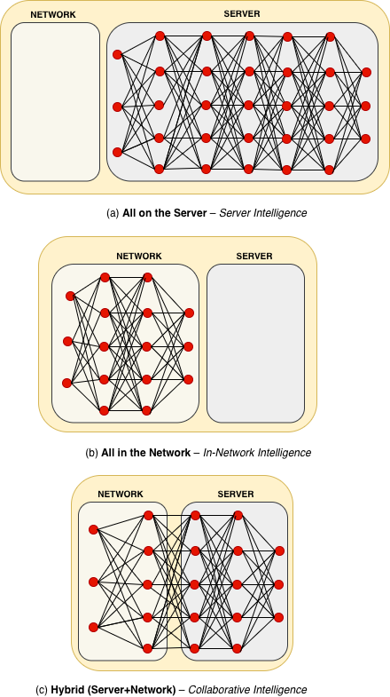

---
title: "Efficient Machine Learning Models for In-Network Traffic Classification"
categories:
  - Blog
tags:
  - AI
  - Communication
  - Networking
---

One use case of SmartNICs includes the offloading of machine learning models to perform inference on incoming network traffic for in-network traffic analysis. However, it is still unclear which types of efficient models are most suitable for offloading to DPU ARM cores and how such offloading can best utilize the available computing resources while maintaining high prediction accuracy.

We analyze and quantify which types of efficient models offloaded to DPU ARM cores are best for efficient use of computing resources and have the highest prediction scores for classifying network traffic.

  

