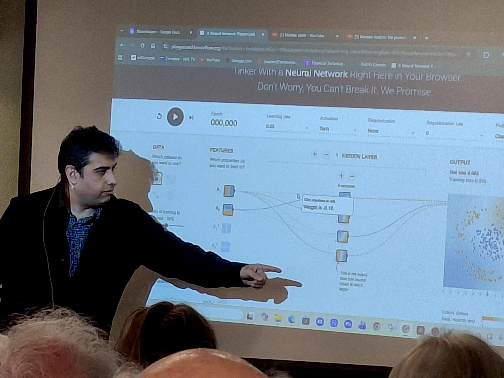

---
title: "Making AI Accessible to Everyone: A Public Talk in Norwegian"
---

  

## Making Artificial Intelligence Accessible to Everyone 🇳🇴

On November 5, 2026, I had the pleasure of delivering a public talk on <strong>Artificial Intelligence (Kunstig intelligens – KI)</strong> at <strong>Vestre Aker Frivilligsentral in Oslo</strong>.

During the presentation, I introduced the fundamentals of AI to a general audience, exploring how humans and machines learn, the evolution of AI, real-world applications, and future possibilities.

This event was particularly meaningful because it was <strong>my first public talk entirely in Norwegian</strong>. It was an opportunity to combine my passion for teaching, technology, and community engagement while developing my Norwegian communication skills.

I believe that <strong>knowledge about AI should be accessible to everyone</strong>, regardless of their technical background.

Many thanks to <strong>Vestre Aker Frivilligsentral</strong> and everyone who attended for the warm welcome and engaging discussions!

